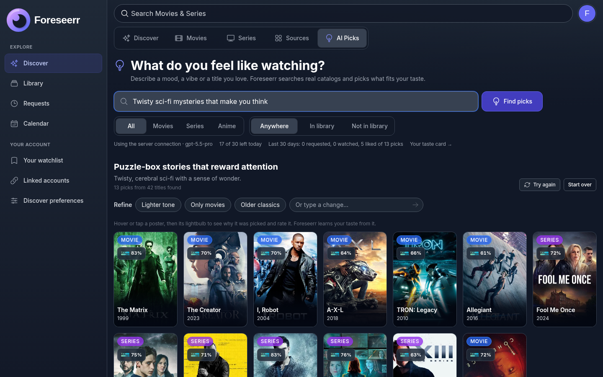
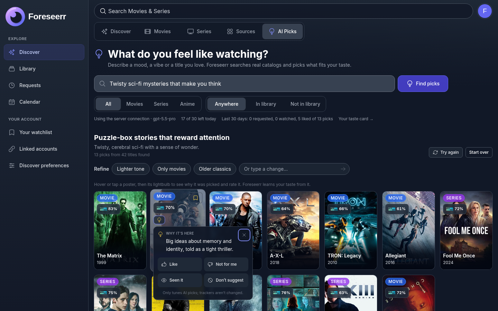
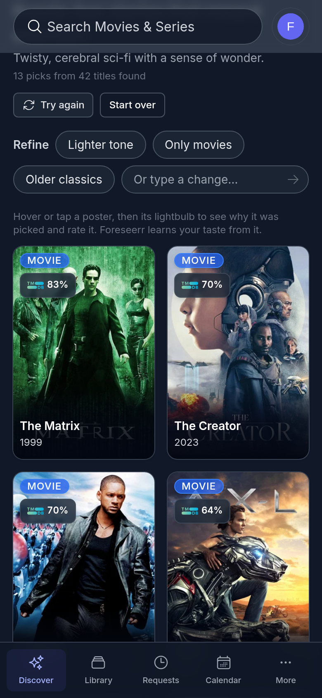
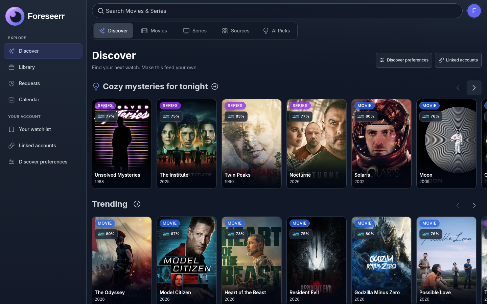
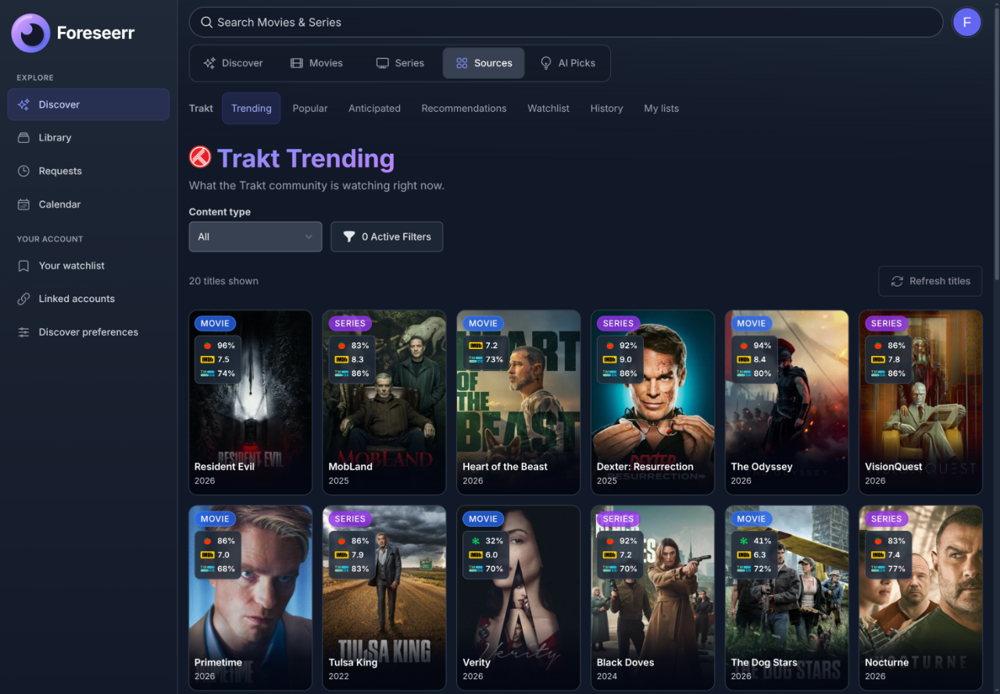
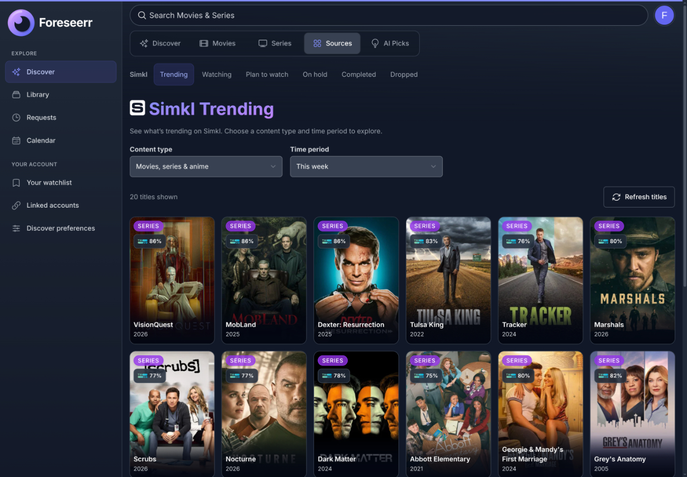
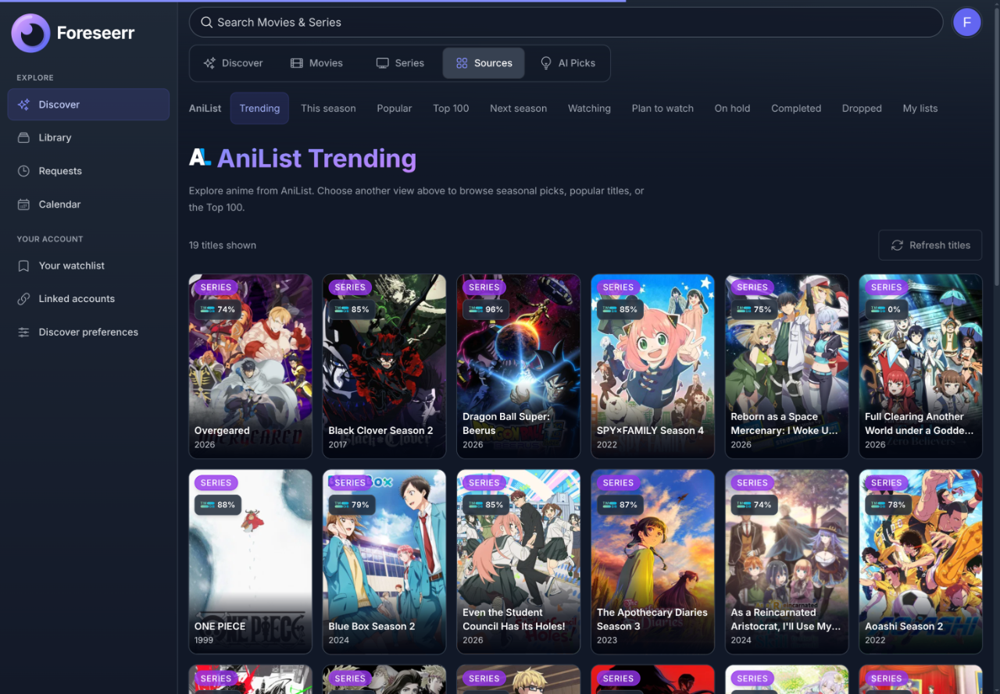
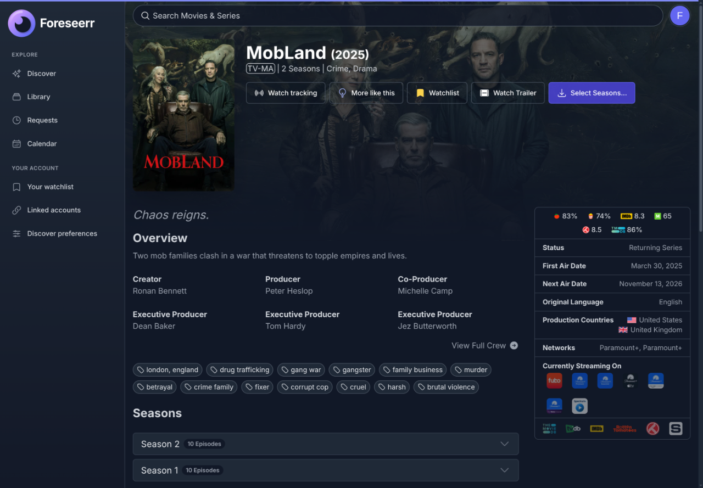
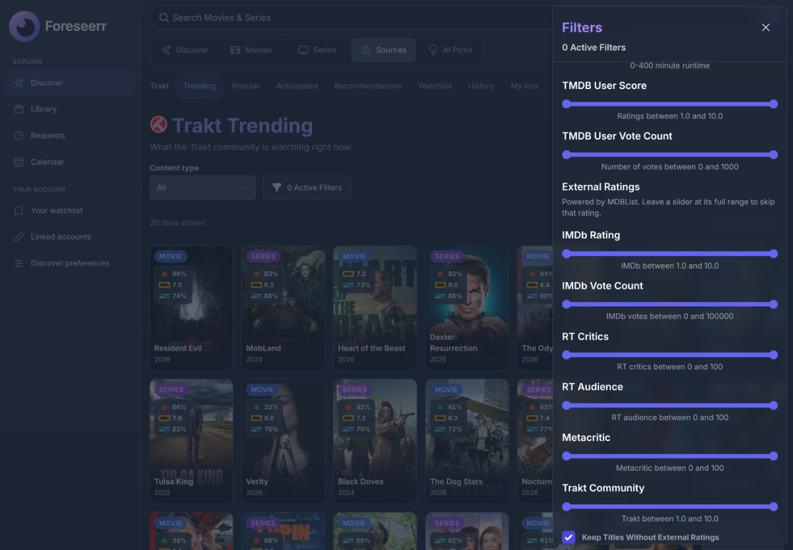

<p align="center">

</p>

**Foreseerr** is a personal fork of [Seerr](https://github.com/seerr-team/seerr) that folds SuggestArr-style discovery and media workflows into the app itself — Trakt, AniList, Simkl, and MDBList browse, a mapping layer to TMDB, Library / Watch Now, AI recommendations, a release calendar, and Servarr interventions — without running a separate suggestion sidecar.

It keeps Seerr’s request pipeline, media-server integrations (Jellyfin / Plex / Emby), and Radarr/Sonarr support. Config paths stay Seerr-compatible (`CONFIG_DIRECTORY`, Docker `/app/config`).

**Jellyfin-first.** Foreseerr’s deeper features — Library / Watch Now, native Desktop playback, Jellyfin watched actions, and the Better Trakt bridge — are built and tested around Jellyfin. Plex and Emby remain supported for Seerr-style sign-in, library scans, requests, and availability. Cross-server features such as Direct Trakt, rating badges (e.g. MDBList), Discover, and the request pipeline work regardless of media server. Full Library and Desktop parity for Plex/Emby is not a current priority; please treat those as best-effort.

**Docs:** [selmant.github.io/foreseerr](https://selmant.github.io/foreseerr/)

## Optional Jellyfin sidecar plugin (alpha)

Foreseerr can also run **inside Jellyfin** as a third-party plugin that supervises the compiled server on localhost and serves it at `/Foreseerr` with SSO. The plugin is developed in [selmant/jellyfin-plugin-foreseerr](https://github.com/selmant/jellyfin-plugin-foreseerr); see the [user guide](docs/using-seerr/jellyfin-plugin.md). This is not an official Jellyfin catalog plugin, and it is in alpha.

## Optional Native Desktop Companion

[Foreseer Desktop](https://github.com/selmant/foreseerr-desktop) is the
optional native companion for Foreseerr. It loads the same hosted Foreseerr UI
in a desktop window and, for supported Jellyfin playback, uses the maintained
[Jellium runtime fork](https://github.com/selmant/jellium-desktop) to play in
that window. It is not required for normal browser use, requests, library
browsing, or any server-side feature.

The desktop binary never replaces this web application: browsers keep their
normal Jellyfin links, while a compatible desktop runtime adds native playback
only after the signed-in user's account is linked to Jellyfin. See the
[native desktop guide](docs/using-seerr/native-desktop.md) for the user-facing
behavior and [Foreseer Desktop](https://github.com/selmant/foreseerr-desktop)
`0.3.0` for installation and release compatibility.

## AI picks that fit your taste

Describe a mood, start from a movie or series you love, or ask for something
based on your taste. Foreseerr searches real catalogs, optionally researches
the web through SearXNG, and explains why each pick fits.



- **Your connection.** Use the admin's OpenAI-compatible endpoint, connect your
  own endpoint when allowed, or link your own ChatGPT account. The active
  connection and model are always visible.
- **Your taste.** Like, pass, or mark a title seen. Requests and feedback
  inform an editable taste card; watch-history sharing is opt-in.
- **Useful filters.** Choose movies, series or anime, and narrow picks to your
  library or titles you still need to request. Refine with a chip or your own words.
- **Less waiting.** Save prompts as personal Discover rows. A nightly job
  refreshes rows for active users and prepares weekly picks, with a weekly
  web-push notification when configured.
- **Control over history and usage.** Delete past requests, choose retention,
  set daily limits and a server monthly token budget, and inspect usage by
  person and model. AI is off until an admin enables it.

<details>
<summary>Why a title was picked, and feedback</summary>



</details>

<details>
<summary>AI Picks on a phone</summary>

<p align="center">

</p>

</details>

See the [AI guide](docs/using-seerr/settings/ai.md) for connections, privacy,
automatic picks, and SearXNG setup. Screenshots use a demo account and sample recommendations.

> [!NOTE]
> Foreseerr `v0.16.0` is the current stable release. Upgrades from `v0.1.0`, `v0.2.0`, `v0.2.1`, `v0.3.0`, `v0.4.x`, `v0.5.x`, `v0.6.x`, `v0.7.x`, `v0.8.x`, `v0.9.x`, `v0.10.x`, `v0.11.x`, `v0.12.x`, `v0.13.x`, `v0.14.x`, and `v0.15.x` are supported. Alpha builds (`0.1.0-alpha.x`) are not a supported upgrade source — start from a fresh install or migrate from Seerr (see the migration guide). Back up your configuration before upgrading.

## Current Features (from Seerr)

- Full Jellyfin/Emby/Plex integration including authentication with user import & management.
- Support for **PostgreSQL** and **SQLite** databases.
- Movies, shows, and mixed libraries.
- Sonarr and Radarr integration with a customizable request system.
- Library scans, granular permissions, notification agents, watchlist & blocklist.
- Mobile-friendly UI.

## Foreseerr extras (on top of Seerr)

Shipped on top of Seerr (requests stay manual; no Discover auto-request bot):

- **Trakt Discover** — recommendations, watchlist, history, and pin public or personal lists (Direct Trakt app or Better Trakt via Jellyfin)
- **AniList Discover** — trending, this season, popular, top 100, next season; linked watching / planning / completed and custom lists
- **Simkl** — PIN-linked library sync, watched/rating actions, and Trending plus personal status rows
- **MDBList** — IMDb / RT / Metacritic / Trakt community badges and filters, plus pin public lists as custom Discover rows
- **AI Picks** — taste-based recommendations, SearXNG research, saved Discover rows, weekly picks, and an editable taste card
- **Mapping layer** — packs + live resolvers so Discover sources reach TMDB; repair unmapped titles in Settings → Mapping
- **Library** — Continue Watching, Recently Added, Ready to Watch, and Jellyfin browse (Jellyfin-linked accounts)
- **Release calendar** — Radarr/Sonarr dates in month or agenda view, with request and manage actions
- **Interventions** — review mapped Radarr/Sonarr queue warnings, import, or reject and blocklist
- Watched / unwatched / score actions (Trakt, optional AniList, Simkl, Jellyfin where linked)
- **Watch ahead** — opt-in from the TV request modal: keep N unwatched episodes requested as you watch in Jellyfin
- Optional [Foreseer Desktop](https://github.com/selmant/foreseerr-desktop) companion for same-window Jellyfin playback

You still click Request on a title. Discover and AI picks never request titles automatically. Watch ahead is an enrolled per-series buffer.



See [Discover](docs/using-seerr/discover.md), [Library](docs/using-seerr/library.md), [Calendar](docs/using-seerr/calendar.md), [Integrations](docs/using-seerr/settings/integrations.md), and [Mapping](docs/using-seerr/settings/mapping.md).

## Browse Trakt, Simkl and AniList

Explore community charts and seasonal anime, or link an account to bring your
own lists and watch history into Discover. Provider titles map to TMDB so you
can open their details and request them through the same workflow.



<details>
<summary>Simkl: trending movies, series and anime</summary>

Choose a content type and time period, or switch to a linked account's watching,
plan-to-watch and completed views.



</details>

<details>
<summary>AniList: trending, seasonal picks and personal lists</summary>



</details>

These screenshots use public chart data in a demo account. Personal library
status and account details are omitted.

## Ratings where you browse

Compare TMDB, IMDb, Rotten Tomatoes critics and audience, Metacritic and Trakt
community scores on title pages. MDBList supplies the external ratings; choose
which badges appear on posters and use rating ranges to narrow Discover results.



<details>
<summary>Filter Discover by external ratings</summary>



</details>

## Installation

Foreseerr is currently distributed as a **Docker image** (recommended). Docker and Docker Compose must be installed on the host; see the [Docker installation guide](https://docs.docker.com/get-docker/) if needed.

GitHub Releases also attach standalone server archives plus `SHA256SUMS`:

- **`foreseerr-linux-x64.tar.gz` / `foreseerr-linux-arm64.tar.gz` / `foreseerr-windows-x64.zip`** — the `foreseerr` server binary next to the web app (`dist/public/`), its API spec (`seerr-api.yml`) and `committag.json`. Keep those files together and start the binary from that directory, then open `http://127.0.0.1:5055`. Config defaults to `config/` in that directory (`CONFIG_DIRECTORY` overrides it). The Linux builds need glibc 2.28 or newer and the system CA certificates (the `ca-certificates` package).
- **`foreseerr-plugin-*`** — the same server built for the Jellyfin plugin's `/Foreseerr` sub-path; the plugin downloads these itself.

Those are the Foreseerr **server**, not [Foreseer Desktop](https://github.com/selmant/foreseerr-desktop). Postgres still needs a real Postgres; Windows SmartScreen will warn on the unsigned `.exe`.

```bash
mkdir foreseerr && tar -xzf foreseerr-linux-x64.tar.gz -C foreseerr
cd foreseerr
NODE_ENV=production CONFIG_DIRECTORY=./foreseerr-config ./foreseerr
```

On Windows, extract `foreseerr-windows-x64.zip` into a folder and run `foreseerr.exe` from it with `NODE_ENV=production` set.

### Docker CLI

Create a persistent directory for Foreseerr’s configuration. The container runs as UID/GID `1000`, so make sure it can write to this directory:

```bash
mkdir -p ./foreseerr-config
sudo chown -R 1000:1000 ./foreseerr-config
```

Start the released image:

```bash
docker run -d \
  --name foreseerr \
  --init \
  --restart unless-stopped \
  -p 5055:5055 \
  -v "$(pwd)/foreseerr-config:/app/config" \
  ghcr.io/selmant/foreseerr:v0.16.0
```

Open `http://localhost:5055` and complete the setup wizard. Keep the `/app/config` volume when updating or recreating the container; it contains your database and settings.

To update, replace the image tag with the version you want, then recreate the container with the same volume mount. Back up `foreseerr-config` before updating.

### Docker Compose

The equivalent production-style Compose service is:

```yaml
services:
  foreseerr:
    image: ghcr.io/selmant/foreseerr:v0.16.0
    container_name: foreseerr
    init: true
    restart: unless-stopped
    ports:
      - "5055:5055"
    volumes:
      - ./foreseerr-config:/app/config
```

Start it with:

```bash
mkdir -p foreseerr-config
sudo chown -R 1000:1000 foreseerr-config
docker compose up -d
```

The image is published at `ghcr.io/selmant/foreseerr`. Prefer an explicit version tag (`v0.16.0`) or a stable alias (`latest`, `v0`, `v0.16`) rather than `develop`.

> Older pulls used `ghcr.io/selmant/seerr`. Point compose/CLI at `ghcr.io/selmant/foreseerr` going forward.

## Migrating from Seerr

Foreseerr uses Seerr-compatible config paths and database settings, so an existing Seerr configuration can be reused when replacing Seerr. Stop the existing instance first, back up its config/database, and do not run both instances against the same config directory or database.

See the [migration guide](docs/migration-guide.mdx) for the evergreen replacement procedure (clone-test, then same `/app/config` volume), supported upgrade sources, and what to do if your Seerr is newer than Foreseerr’s last upstream sync.

## API Documentation

With a running instance: http://localhost:5055/api-docs

Foreseerr serves the [Seerr](https://github.com/seerr-team/seerr) `/api/v1` API, so tools built for Seerr (and for Overseerr and Jellyseerr before it) keep working against it. CI checks the API against upstream's spec on every change. Operations Foreseerr adds are marked `x-foreseerr` in [`seerr-api.yml`](seerr-api.yml). See [upstream/README.md](upstream/README.md) for what is guaranteed and how upstream changes are tracked.

## Upstream

Foreseerr began as a fork of [seerr-team/seerr](https://github.com/seerr-team/seerr), and its frontend and much of its request logic come from Seerr and its predecessors, Overseerr and Jellyseerr. The backend has been rewritten in Rust, so upstream is no longer merged. Instead, upstream fixes are ported, and a weekly job lists every upstream commit not yet reviewed; [upstream/sync.json](upstream/sync.json) records how far that review has got. See [upstream/README.md](upstream/README.md).

## License

MIT (same as Seerr).
